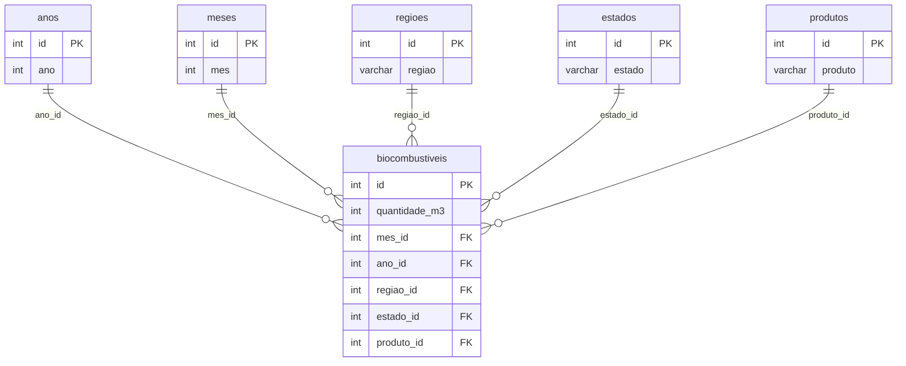

# ETL de Dados Públicos sobre Biodiesel no Brasil

## 🎯 Sobre o projeto

**O problema:** Os dados públicos da ANP sobre as matérias-primas usadas na produção de biodiesel vêm num CSV com texto acentuado e em maiúsculas, com região, estado e produto repetidos em cada linha. Para consultar esse volume por produto, região, estado e ano, é mais prático ter os dados num banco relacional.

**O que o projeto entrega:** Um pipeline que lê o CSV, limpa e padroniza os dados com Python (pandas), separa as categorias repetidas em tabelas próprias e gera os scripts SQL que montam um banco MySQL com uma tabela de fatos, cinco tabelas de dimensão e seis views de consulta.

**Quem usaria:** Um cenário plausível é uma pessoa da área de dados ou de planejamento que precise consultar em SQL quanto de cada matéria-prima foi usado, por região, estado e ano. O projeto usa dados públicos e não tem cliente real, então esse uso é um cenário, não um caso aplicado.

**O resultado:** Um banco com 4.745 registros (jan/2017 a ago/2023) e 39.912.750 m³ de matéria-prima. O óleo de soja responde por 69,3% do total, e Sul e Centro-Oeste somam 82,8%. As views devolvem esses totais prontos (veja os exemplos mais abaixo).

**Ressalvas importantes:** os scripts são montados para rodar uma vez, num banco vazio, e a importação para o MySQL é manual: o Python gera os arquivos `.sql`, mas não se conecta ao banco (veja Como Rodar e Limitações).

---

## 📖 Etapas do Projeto

### 1. Coleta dos Dados

- **Fonte:** [Painéis de Produção de Etanol e de Biodiesel](https://dados.gov.br/dados/conjuntos-dados/paineis-de-producao-de-etanol-e-de-biodiesel), ANP
- **Arquivo:** Matéria-Prima utilizada na Produção de Biodiesel (CSV)
- **Período:** jan/2017 a ago/2023 (80 meses)
- **Tamanho:** 4.745 linhas, uma por mês, estado e produto (14 produtos, 14 estados e 5 regiões)

### 2. Tratamento (ETL) com Python

O notebook [`notebooks/projeto_mp_biodiesel.ipynb`](notebooks/projeto_mp_biodiesel.ipynb) faz a limpeza e a transformação:

- Padronização de texto: tudo em minúsculas e sem acentos (com *Unidecode*), inclusive nos nomes das colunas.
- Separação de `mês/ano` em duas colunas e renomeação de `quantidade (m³)` para `quantidade_m3`.
- Criação das tabelas de dimensão (anos, meses, regiões, estados e produtos) com um identificador para cada valor único, e troca dos textos por esses identificadores na tabela de fatos.
- Geração dos scripts `INSERT` de cada tabela, gravados em `sql/`.

O notebook foi feito no Google Colab e também roda localmente.

### 3. Armazenamento em Banco de Dados (MySQL)

Os scripts de [`sql/`](sql) criam o banco `biocombustiveis`, as tabelas, os dados e as views.



A tabela `biocombustiveis` guarda uma linha por mês, estado e produto. Ela tem a região e o estado, embora cada estado pertença a uma única região (a região poderia ser obtida a partir do estado).

**Views:**

| View | O que devolve |
|---|---|
| `lista_produtos` | Lista de produtos em ordem alfabética |
| `m3_por_produto` | Total de m³ por produto, do maior para o menor |
| `m3_por_regiao` | Total de m³ por região |
| `m3_por_estado` | Total de m³ por estado |
| `m3_por_ano` | Total de m³ por ano |
| `m3_produto_ano` | Total de m³ por produto e por ano |

### 4. Exemplos de resultado

Resultado de `select * from m3_por_regiao;`:

| id | regiao | total_m3 |
|---|---|---|
| 5 | sul | 17.097.248 |
| 1 | centro oeste | 15.950.241 |
| 3 | nordeste | 3.029.745 |
| 2 | sudeste | 2.948.836 |
| 4 | norte | 886.680 |

Resultado de `select * from m3_por_ano;` (2023 vai só até agosto):

| id | ano | total_m3 |
|---|---|---|
| 3 | 2021 | 6.817.292 |
| 4 | 2020 | 6.541.616 |
| 2 | 2022 | 6.424.381 |
| 5 | 2019 | 6.035.512 |
| 6 | 2018 | 5.282.041 |
| 1 | 2023 | 4.783.676 |
| 7 | 2017 | 4.028.232 |

<details>
<summary><b>Os 5 principais produtos (<code>m3_por_produto</code>)</b></summary>

| id | produto | total_m3 |
|---|---|---|
| 10 | oleo de soja (glycine max) | 27.671.746 |
| 11 | outros materiais graxos | 4.891.405 |
| 2 | gordura bovina | 3.864.735 |
| 4 | gordura de porco | 892.772 |
| 9 | oleo de palma/dende (elaeis guineensis ou elaeis o | 817.583 |

</details>

---

## ⚠️ Limitações

- **Os scripts rodam uma vez, num banco vazio.** O `01_create_tables.sql` dá erro se o banco `biocombustiveis` já existe, e reexecutar um `INSERT` de dimensão duplica as linhas em silêncio (as tabelas não têm restrição de unicidade). Como os identificadores dos fatos dependem da ordem de inserção das dimensões, uma duplicação desalinha os dados.
- **A importação para o MySQL é manual.** O Python gera os arquivos `.sql`, mas não se conecta ao banco.
- **Região e estado ficam juntos na tabela de fatos**, o que é uma redundância (a região é determinada pelo estado).
- **As views devolvem `total_m3` como texto formatado** (por exemplo, `27.671.746`). É prático para ler, mas não dá para somar ou ordenar esses valores fora da view.
- **2023 está incompleto** (jan a ago), então não é comparável aos outros anos.

---

## ⚙️ Como Rodar

Testado com Python 3.11 e MySQL 8.0.

### Gerar os scripts SQL (opcional)

Os scripts de `sql/` já estão no repositório. Para regenerá-los a partir do CSV:

```bash
pip install -r requirements.txt
cd notebooks
jupyter notebook projeto_mp_biodiesel.ipynb
```

Rode o notebook a partir da pasta `notebooks/`: ele lê `../data/biodiesel-materia-prima.csv` e grava os arquivos em `../sql/`. No Google Colab, suba o CSV na pasta da sessão antes de executar.

### Criar o banco no MySQL

Execute os scripts na ordem, a partir da raiz do repositório (troque `SEU_USUARIO`; o MySQL pede a senha):

```bash
mysql -u SEU_USUARIO -p < sql/01_create_tables.sql
cat sql/0[2-7]_*.sql | mysql -u SEU_USUARIO -p biocombustiveis
mysql -u SEU_USUARIO -p < sql/08_create_views.sql
```

Para consultar:

```sql
use biocombustiveis;
select * from m3_por_regiao;
```

Notas:
- Rode uma vez, em banco vazio. Para recomeçar do zero, apague o banco com `DROP DATABASE biocombustiveis;` (isso apaga o banco com esse nome) e repita os três comandos.
- O `08_create_views.sql` imprime a lista de produtos ao final, porque termina com um `select`. É esperado.
- No MySQL Workbench, abra e execute os arquivos na mesma ordem.

<details>
<summary><b>📁 Estrutura do repositório</b></summary>

    etl-biodiesel-python-mysql/
    ├── data/
    │   └── biodiesel-materia-prima.csv
    ├── notebooks/
    │   └── projeto_mp_biodiesel.ipynb
    ├── sql/
    │   ├── 01_create_tables.sql
    │   ├── 02_insert_meses.sql
    │   ├── 03_insert_anos.sql
    │   ├── 04_insert_regioes.sql
    │   ├── 05_insert_estados.sql
    │   ├── 06_insert_produtos.sql
    │   ├── 07_insert_biocombustiveis.sql
    │   └── 08_create_views.sql
    ├── requirements.txt
    ├── .gitattributes
    ├── .gitignore
    └── README.md

</details>

---

## 🔗 Projetos relacionados

- [supervised-learning-biodiesel-regressao](https://github.com/bavsvalle/supervised-learning-biodiesel-regressao): regressão linear múltipla sobre os mesmos dados.
- [unsupervised-learning-biodiesel-acm](https://github.com/bavsvalle/unsupervised-learning-biodiesel-acm): K-means e Análise de Correspondência Múltipla (ACM) sobre os mesmos dados.
- [unsupervised-learning-clustering](https://github.com/bavsvalle/unsupervised-learning-clustering): clusterização hierárquica e K-means sobre os mesmos dados.
